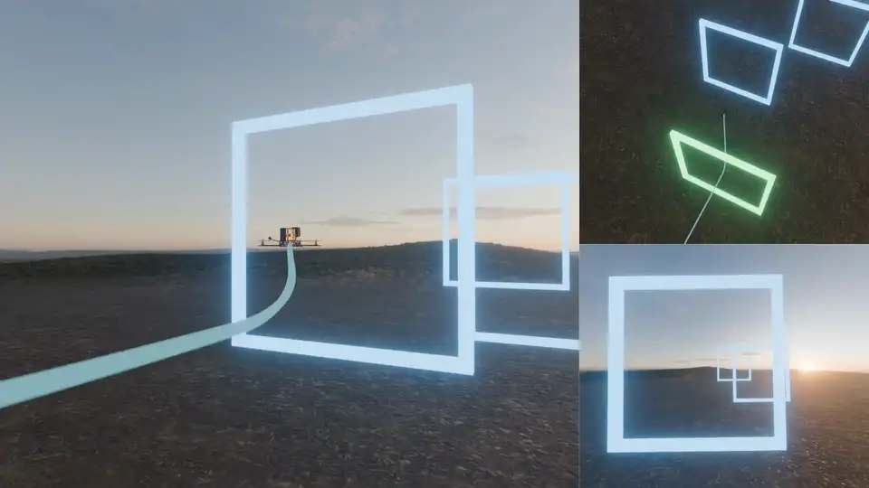

# Autonomous Drone Racing Competition for Applied Optimal Control (M2795.007200), Fall 2026

## Installation

Run from the project root. Conda is the default setup and pins Python 3.12.12 with the verified package versions.

```bash
conda env create -f environment.yml
conda activate aoc-drone-racing
```

Alternatively, with Python 3.12 and venv:

```bash
python3.12 -m venv .venv
source .venv/bin/activate
python -m pip install -r requirements-dev.txt
python -m pip install --no-deps -e .
```

## How to run

Implement `Controller.reset(config)` and `Controller.act(observation)` in `controller.py`.
The interface (observation, config and action) is documented at the top of that file.

```bash
# Simulate and score a controller (default: four-gate demo track)
quad-race run --controller controller.py --log outputs/nominal.json
quad-race run --controller controller.py --render            # live 3D view
quad-race run --render-to outputs/nominal.png                # headless image

# Ten-gate random track (the baseline controller needs ~51 s)
quad-race run --track tracks/ten_gates.json --max-time 90 --log outputs/ten_gates.json

# Disturbed scenario: smooth wind up to 0.5 m/s, mass error up to ±5%
quad-race run --wind 0.5 --mass-error 0.05 --seed 17 --log outputs/perturbed.json

# Generate a new random track
quad-race make-track tracks/random_seed7.json --gates 10 --seed 7

# Replay a saved log
quad-race replay outputs/nominal.json --show
quad-race replay outputs/nominal.json --output outputs/replay.gif
```

## Example optimal controllers

Two example racers live in `examples/`. Each is a complete single-file submission: copy it to `controller.py`, or pass it with `--controller`.

- `examples/mpc_controller.py`: nonlinear MPC solved with iLQR (Gauss-Newton DDP) over a 1 s horizon. Input bounds are built into the model through tanh squashing. A smooth "gate funnel" cost keeps the drone centred near upcoming gates.
- `examples/mppi_controller.py`: MPPI with 768 sampled rollouts per step. Crossing a gate outside its opening or leaving the bounds is a hard penalty in the cost.

Both use `quad_race.planning`, an optional helper module, for a racing line through the gate centres with a speed profile, a batched quadrotor model that includes RotorPy's rotor drag and translational lift, and a disturbance observer. `LINE` at the top of each file sets how aggressive the racing line is, and it is the main lap-time knob.

```bash
python examples/benchmark.py                                     # ten-gate track
python examples/benchmark.py --wind 0.5 --mass-error 0.05 --seed 17
python examples/benchmark.py --log-dir outputs/benchmark         # save logs for replay
# Disturbance sweep over several seeds, in parallel (timing columns are then inflated)
python examples/benchmark.py --controllers mpc mppi --wind 2 --mass-error 0.2 --seeds 1 2 3 4 5 --jobs 8 --max-time 30
```

Ten-gate track (`tracks/ten_gates.json`), nominal scenario, Apple Silicon laptop:

| Controller | Status | Score [s] | Peak load [g] | Mean `act()` [ms] |
|---|---|---|---|---|
| baseline (`controller.py`) | finished | 50.79 | 1.10 | 0.1 |
| MPC (iLQR) | finished | 6.06 | 3.46 | 17 |
| MPPI | finished | 5.37 | 2.85 | 18 |

With wind 0.5 m/s and ±5% mass error (seeds 1–3), the scores stay within 0.05 s of these. Both also finish wind 1 m/s with ±10% mass error (seeds 1–5) and wind 2 m/s alone. With mass error up to ±20%, both crash on seed 4, where the drone is 18% heavier than nominal: the default racing lines leave too little thrust margin for that. Both controllers also finish the four-gate track and six random 10-gate tracks (`random_track` seeds 1, 2, 3, 5, 6, 7) with their default settings.
## Rendering

`quad-race replay` is enough to check a run. For something to put on a screen,
`tools/render_blender.py` turns the same log into an MP4 with Blender.

[](demo/four_gates.mp4)

The baseline controller around `tracks/four_gates.json`, in the default
three-pane layout. [`demo/four_gates.mp4`](demo/four_gates.mp4) is the whole 17 s
clip; renders otherwise land in the gitignored `outputs/`.

`bpy` ships no cp312 wheel, so the renderer gets an env of its own:

```bash
conda env create -f environment-render.yml        # once
python tools/fetch_assets.py                      # once: ~48 MB of free assets

env -u DISPLAY conda run -n aoc-render \
  python tools/render_blender.py outputs/run.json --drone --env
```

**Always pass `env -u DISPLAY`.** With a display set Blender falls back to
software Mesa; without one it picks up NVIDIA's EGL and the GPU. That is 0.76 s
against 11.28 s for a single frame.

| Flag | Default | Notes |
| --- | --- | --- |
| `--cam` | three-pane: chase left, overhead and FPV stacked right | Render one view full frame |
| `--res` | `1920x1080` | Cheap to raise: 2.25x the pixels of 720p costs ~15% |
| `--stride` | `2` (25 fps) | Every Nth sample, frame rate dropped to match. The one knob that scales linearly |
| `--drone` | built-in airframe | Use the downloaded FPV model |
| `--env` | code-lit dark room | Light from an HDRI, which also becomes the ground |
| `--arena` | off | Floor grid and perimeter pylons, on either floor |

### Downloaded assets

`tools/fetch_assets.py` pulls three free BlenderKit assets into the gitignored
`tools/assets/`. Two are royalty-free rather than CC0: render with them, do not
redistribute them. Deleting the folder only ever costs a download.

| Asset | License | Downloaded | Source |
| --- | --- | --- | --- |
| FPV Drone, Dovydas Alytas | royalty-free | 2K, 16.6 MB | [BlenderKit](https://www.blenderkit.com/asset-gallery-detail/79365807-cdb4-434a-9a7e-05b77beb6597/) |
| Dry Flattened Gravel Dirt Path | royalty-free | 2K, 8.5 MB | [BlenderKit](https://www.blenderkit.com/asset-gallery-detail/84deca31-2aef-4165-9b1e-cefb5c8af1ab/) |
| Aarfontein Sunrise, Poly Haven | CC0 | 4K, 22.9 MB | [BlenderKit](https://www.blenderkit.com/asset-gallery-detail/dc6aa810-3fc9-4870-bbc7-7bf0bcb9395f/), [Poly Haven](https://polyhaven.com/a/aarfontein_sunrise) |

### What a render costs

Three-pane 1080p at 25 fps, downloaded airframe and HDRI, on an RTX 4090 over
EGL. `tracks/` ships both courses:

| Track | Gates | Flight | Simulated in | Frames | Render | with `--arena` |
| --- | --- | --- | --- | --- | --- | --- |
| `four_gates` | 4 | 17.31 s | 23.88 s | 434 | 316 s | 329 s |
| `ten_gates` | 10 | 50.79 s | 42.77 s | 1271 | 982 s | 961 s |

About 0.75 s per output frame. `--stride` is the only knob that changes the
frame count; one camera instead of three is roughly half, and `--arena` costs
nothing either way.

## References

- RotorPy: https://github.com/spencerfolk/rotorpy (MIT License, Copyright 2023 RotorPy Authors).
- Spencer Folk, James Paulos, Vijay Kumar, "RotorPy: A Python-based Multirotor Simulator with Aerodynamics for Education and Research", ICRA 2023 UAV simulator workshop: https://arxiv.org/abs/2306.04485.
- RotorPy is used as an external dependency; no modified copy of its source is included. Preserve its copyright and license notice when redistributing.

Rendering assets, fetched on demand by `tools/fetch_assets.py` and never committed:

- "FPV Drone" by Dovydas Alytas, BlenderKit, royalty-free: https://www.blenderkit.com/asset-gallery-detail/79365807-cdb4-434a-9a7e-05b77beb6597/
  Royalty-free permits rendering with the model but not redistributing the model itself.
- "Dry Flattened Gravel Dirt Path", BlenderKit, royalty-free: https://www.blenderkit.com/asset-gallery-detail/84deca31-2aef-4165-9b1e-cefb5c8af1ab/
  Same terms as above: render with it, do not redistribute it.
- "Aarfontein Sunrise" by Poly Haven, CC0: https://polyhaven.com/a/aarfontein_sunrise
  Mirrored on BlenderKit: https://www.blenderkit.com/asset-gallery-detail/dc6aa810-3fc9-4870-bbc7-7bf0bcb9395f/
- BlenderKit: https://www.blenderkit.com/ - its free and CC0 assets download without an API key.
- Blender is used through the `bpy` PyPI module (GPL); it is a separate environment and no Blender source is included.
