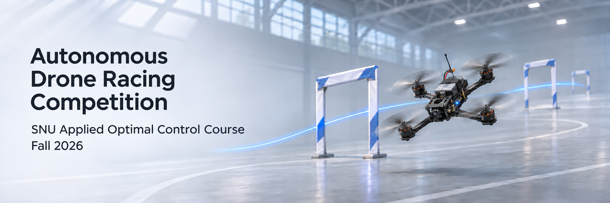
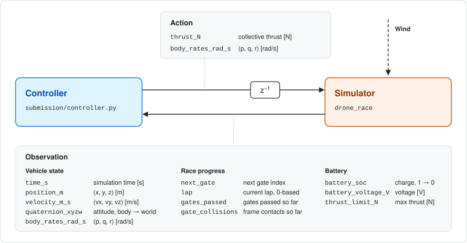

# Autonomous Drone Racing Competition
### Final Project for Applied Optimal Control (M2795.007200), Fall 2026, Seoul National University



Welcome to the Autonomous Drone Racing competition for Applied Optimal Control Course!

> [!IMPORTANT]
> This [README.md](README.md) explains how to use this repository.  
> See [COMPETITION.md](COMPETITION.md) for the race rules, quadrotor dynamics, disturbances, etc.

## Code structure

| Directory | Explanation | Do you edit it? |
|---|---|---|
| `submission/` | Your controller. The main code goes in `controller.py`. Put everything else in `assets/`: learning code, modules you split out, weights and other files. This is the folder you submit. | O |
| `examples/` | A simple PD controller to start from |  |
| `config/tracks/` | The five tracks: `eight`, `twisted_eight`, `inner_loop`, `trefoil` and `coaster`, each in `<shape>.json` (track name `<shape>_track`). The official track is one of them with its gates moved at random (COMPETITION.md Section 3). `<shape>.png` shows each track from above, in 3D and as an altitude profile |  |
| `config/race.json` | The default race (track, laps, disturbance) for `drone-race run`. Edit it to experiment; `git checkout config/race.json` restores it | O (for experiments) |
| `config/server_evaluation_race.json` | The laps, randomization and seed the practice server uses for every upload, on each of the five tracks |  |
| `src/drone_race/` | Simulator, referee, scoring, helper modules and the `drone-race` command |  |
| `outputs/` | Run logs and track pictures written by `drone-race` | Will be generated |

## Installation

### Conda (Recommended)

From the project root (installs Python 3.12.12 and the tested package versions):

```bash
conda env create -f environment.yml
conda activate aoc-drone-racing
```

### venv

With Python 3.12:

```bash
python3.12 -m venv .venv
source .venv/bin/activate
python -m pip install -r requirements.txt
python -m pip install --no-deps -e .
```

Either way you get the `drone_race` package (editable install) and the `drone-race` command.

## Instructions

Everything you submit goes in `submission/`:

```
submission/
  controller.py        # defines Controller; the interface is documented at its top
  assets/              # everything else: modules, learning code, weights, precomputed trajectories, ...
    my_model.py        # imported from controller.py as `from assets import my_model`
```

`controller.py` must define a class `Controller` with two methods:

```python
from drone_race import Action, Observation, PublicConfig

class Controller:
    def reset(self, config: PublicConfig) -> None:    # once, before the flight
        ...
    def act(self, observation: Observation) -> Action:  # every control step (50 Hz)
        return Action(thrust_N=4.9, body_rates_rad_s=(0.0, 0.0, 0.0))
```



The types are defined in `src/drone_race/api.py`:

- `PublicConfig`: `track` (`gates`, `obstacles`, `bounds`, `start`), `laps`, `control_dt_s`, `physics_dt_s`, `nominal_mass_kg`, `gravity_m_s2`, `thrust_min_N`/`thrust_max_N`, `body_rate_limit_rad_s`, `body_rate_gain_s_inv`, `vehicle_radius_m`, `act_budget_s`, `reset_budget_s` and the `battery_*` parameters. Each `Gate` has `center`, `yaw_rad`, `width_m`/`height_m` (inner opening) and `frame_m`.
- `Observation`: `time_s`, `position_m`, `velocity_m_s`, `quaternion_xyzw` (body → world), `body_rates_rad_s`, `next_gate`, `lap` (0-based), `gates_passed`, `gate_collisions`, `battery_soc`, `battery_voltage_V`, `thrust_limit_N`.
- `Action`: `thrust_N` (collective thrust along body +z) and `body_rates_rad_s` (p, q, r).

The limits on each value and what happens when one is exceeded are in [COMPETITION.md](COMPETITION.md). The docstring of `submission/controller.py` lists the same interface.

The `submission/controller.py` template only hovers at the start position. Replace `reset()` and `act()`, or start from `examples/pd_controller.py`.

How the controller is run:

- It runs in a separate process and talks to the simulator only through JSON messages.
- Its working directory is `submission/`, which is also on `sys.path`, so `open("assets/w.npz")` and `from assets import my_model` work.
- It gets one thread, no GPU, and the package versions in `requirements.txt`.
- `print()` output goes to stderr.

### Optional helper modules

You can import these from your controller:

| Module | What it offers |
|---|---|
| `drone_race.battery` | The battery equations the simulator uses: `terminal_voltage`, `thrust_limit`, `current`, `BatteryModel.step`, ... |
| `drone_race.helpers` | `track_position`: a PD position tracker that returns an `Action` (optional velocity feedforward `target_velocity`, gains `kp`/`kd`, `max_accel`) |
| `drone_race.rules` | The referee's gate geometry: `gate_local`, `inside_opening`, `frame_boxes`, ... |
| `drone_race.randomize` | How races are randomized: `perturb_track` (moved gates), `random_wind_zones`, `threads_gates` (the acceptance check) |
| `drone_race.trackplot` | `plot_track(track)` returns a matplotlib figure (top view with pass directions, 3D view, altitude profile); `save_track_plot(track, path)` saves it as a PNG |

## Running

```bash
drone-race run                          # submission/ on config/race.json, then a playback window
drone-race run --laps 1                 # just one lap
drone-race run --headless               # no window: print the result only
drone-race run --seed 5                 # another random track and wind (moved gates, new wind zones)
drone-race run --fixed                  # the unmoved track, no wind zones (turbulence only)
drone-race run --calm                   # no wind zones and no turbulence
drone-race run --turbulence 1.0         # stronger turbulence (std in m/s, 0 to 2)
drone-race run --debug                  # controller inside this process: breakpoints/pdb work, timing not enforced

drone-race run --controller examples/pd_controller.py --laps 2    # any controller folder or .py file
drone-race run --track config/tracks/eight.json              # any track: 1 lap, no disturbance
drone-race run --race path/to/race.json                          # any race file

drone-race replay outputs/submission_practice.json                # watch a saved run again
drone-race replay outputs/submission_practice.json --output outputs/replay.gif
drone-race make-track outputs/random.json --gates 10 --seed 3     # a seeded random track for testing (+ outputs/random.png)
drone-race plot-track config/tracks/twisted_eight.json               # picture of a track -> config/tracks/twisted_eight.png
drone-race plot-track --race config/race.json --seed 5   # the track and wind zones of seed 5 -> outputs/<track>-seed5.png
```

`run` simulates the whole race first, printing each lap time, and then opens a window that replays the flight in real time (`--speed 2` for double speed). Drawing therefore never affects the controller's timing. The window shows the course and flight path, a chase view, roll/pitch/yaw, and the battery's charge [%] and terminal voltage over time. The terminal shows the status, score, lap times, gate collisions, `act()` timing, peak tilt and battery use.

### Race files

A race file sets the track, laps, randomization and disturbance. `config/race.json` is the default:

```json
{
  "name": "practice",
  "track": "tracks/eight.json",
  "laps": 5,
  "randomize": {"gate_shift_m": 1.0, "gate_height_m": 0.5, "gate_yaw_deg": 15.0, "wind": true},
  "scenario": {
    "seed": 0,
    "turbulence_m_s": 0.6,
    "max_time_s": 900.0
  }
}
```

`randomize` moves every gate a little and places three wind zones on the course, the same way as in the official race (COMPETITION.md Sections 3 and 5). Both come from the seed: each `--seed` gives a different track and wind, and the same seed always gives the same ones. `--fixed` skips `randomize` and uses the original track with the file's own `wind_zones` (none in this file). Without `randomize`, a race uses its track as is and the `wind_zones` it lists, for example:

```json
"wind_zones": [{"name": "east crosswind", "lower": [12, -3, 0], "upper": [20, 5, 6],
                "direction": [1, 0, 0], "speed_m_s": [1.5, 3.0], "heading_jitter_deg": 30, "ramp_m": 1.5}]
```

The `track` path is relative to the race file. The scenario fields are those of `Scenario` (`src/drone_race/env.py`) and `WindZone` (`src/drone_race/wind.py`). `--laps`, `--seed`, `--turbulence`, `--calm` and `--max-time` override the file. Save other variants (another track, larger gate moves, stronger turbulence) as separate files and pass them with `--race`. `config/race.json` uses the same laps, turbulence and randomization as the official race.

The practice server ignores your `config/race.json`: it flies every upload on the five tracks in turn, each with the settings in `config/server_evaluation_race.json`. That file points to `eight`, so `drone-race run --race config/server_evaluation_race.json` reproduces the first course. For another course, copy the file within `config/`, change its `"track"` (e.g. `"tracks/trefoil.json"`) and pass the copy with `--race`.

### Logs

Each run is saved to `outputs/<submission>_<race>.json` (or the `--log` path):

- `summary`: status, score (`score_s` = time + `penalty_s`), lap times, gates passed, gate collisions, `act()` timing (mean, p99, max, deadline misses), peak tilt and load, battery use, thrust-limited steps.
- `events`: gate passes, gate collisions (`gate_collision`, one per contact), laps and the terminal event, with times.
- `samples`: the state, battery, true wind and applied action at every control step.
- `config`, `scenario`, `realization` (the zone winds the seed drew) and `provenance`.

## Timing on your computer

`act()` must return within 20 ms of CPU time on the scoring server (COMPETITION.md Section 7). `drone-race run` applies the same 20 ms limit on your computer, which may be faster or slower than the server. The practice server runs on the scoring hardware, so check your `act()` times and late calls there.

## Checking a submission

```bash
drone-race check                # layout, size, packages and a short flight: must end with "OK"
```

## Submitting

Submit through the practice server, https://admin-aoc-drone-race-live.tailfeb8a3.ts.net/, by **Dec 8, 2026, 23:59 KST**:

1. Upload `submission/controller.py`, or a ZIP of `submission/` with `controller.py` and `assets/` (at most 50 MiB and 1,500 files).
2. Press **Play**. The server flies that version on the five tracks in turn and shows each course's score, timing and a replay.
3. Select a version and press **Final submit**. The last version you confirm before the deadline is your competition entry (COMPETITION.md Section 2).

## Example controller

`examples/pd_controller.py` is a complete single-file submission. Copy it to `submission/controller.py`, or run it with `--controller`. It chases a point along the next gate's axis at a fixed 2.5 m/s, using the `track_position` PD loop from `drone_race.helpers`. It finishes reliably but slowly.

To go faster, write your own planner, prediction model and controller. The vehicle model is in COMPETITION.md Section 4. To compare versions over several disturbance draws, run them with different seeds:

```bash
for seed in 1 2 3 4 5; do drone-race run --headless --seed $seed; done
```

## References

- RotorPy: https://github.com/spencerfolk/rotorpy (MIT License, Copyright 2023 RotorPy Authors).
- Spencer Folk, James Paulos, Vijay Kumar, "RotorPy: A Python-based Multirotor Simulator with Aerodynamics for Education and Research", ICRA 2023 UAV simulator workshop: https://arxiv.org/abs/2306.04485.
- This repository uses RotorPy as an external dependency and includes no modified copy of its source. Keep its copyright and license notice if you redistribute it.

## Acknowledgement

This repository was developed by the teaching assistants of Applied Optimal Control (M2795.007200) at Seoul National University, Fall 2026. If you would like to reuse or adapt it, please contact us through the [AAIL website](https://aail.snu.ac.kr).
